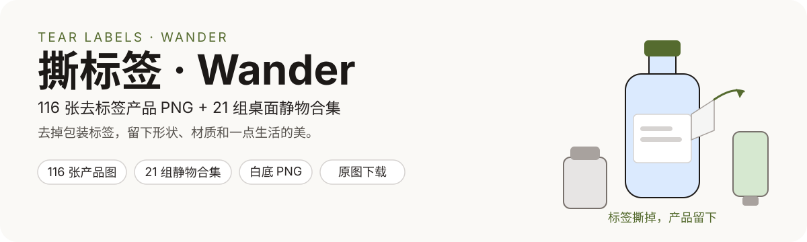
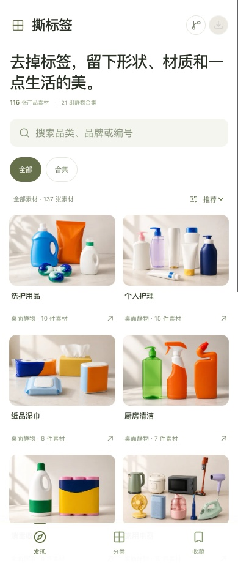
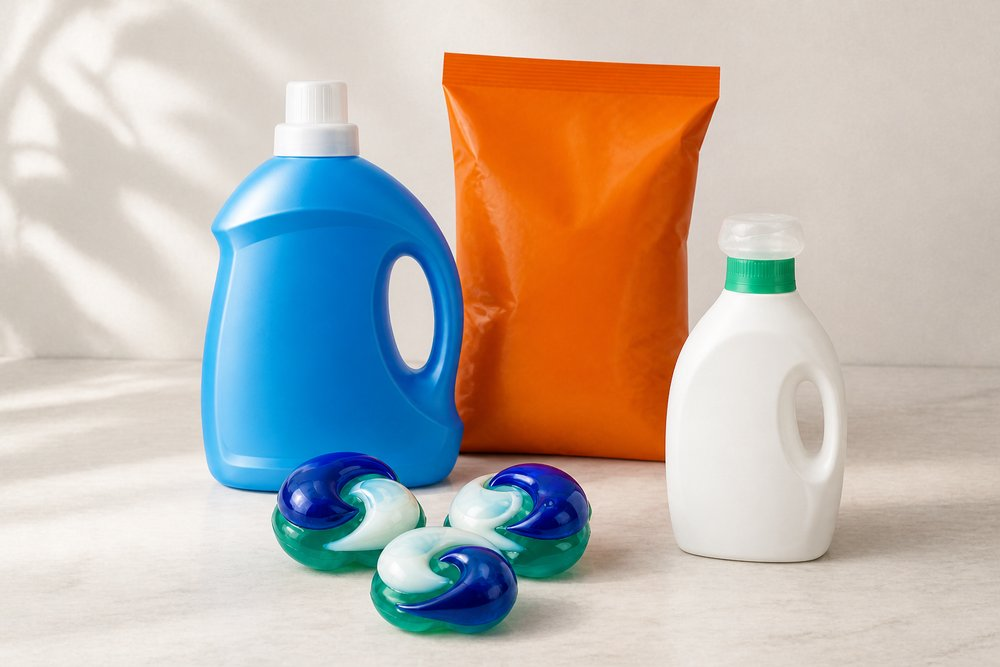

<p align="right"><a href="README.md">中文</a></p>

<p align="center">
  
</p>

<p align="center">
  <a href="https://daily-necessities-library.xiaosang.cc/">▶ View Online</a>
  ·
  <a href="https://github.com/holynova/daily-necessities-library">GitHub Repository</a>
  ·
  <a href="https://holynova.github.io/daily-necessities-library/">Mirror</a>
</p>

Tear Labels is a library of unbranded daily-necessity images: 116 label-free product PNGs plus 21 desktop still-life sets. Logos, trademarks, and label text are all removed — only the product's shape, material, and color remain, on a uniform white product-photography background, ready to use. The Wander interface browses them with olive category tags, a two-column waterfall, and bottom navigation, with collections first on the homepage.

## Screenshots

<p align="center">
  
  
</p>

## Contents

- **116 product images**: top-40 daily necessities (laundry detergent, shampoo, toothpaste, tissues, kitchen cleaning, small appliances, drinks & food…) + 36 brand features (P&G, Nestlé, PepsiCo, Unilever, Moutai, Yili, Blue Moon, tissues) + 40 new FMCG items (Coca-Cola, Tide, Crest, Red Bull, Starbucks…).
- **21 still-life sets**: 14 category sets (laundry care, personal care, paper goods, kitchen cleaning…) + 7 FMCG sub-category sets, each a single desktop still-life photo.
- **De-labelling standard**: packaging surfaces intact — no labels, no leftover lettering, no torn edges, no glue marks; no logos, trademarks, or efficacy claims shown.
- **Image names and brand references follow the existing asset metadata**; downloads keep the original white-background PNG. 「最常见」 ("Most common") is a representative selection, not a sales ranking.

## Features

- **Category browsing, full-library search**: search by category, brand, or number; sort by recommended / newest / name.
- **Local favorites**: favorites are stored in the browser.
- **Original downloads**: WebP thumbnails in lists, high-res WebP once decoded in detail view, original PNG on download.
- **Sharing**: share QR code and PNG poster export.
- **Browsing experience**: first batch of 12, more on scroll; four columns on desktop, two on mobile; keyboard navigation, touch swipe, reduced motion support.

## Run Locally

```bash
npm ci
npm run dev
```

Generate detail images and thumbnails (sharp):

```bash
npm run assets:details
npm run assets:thumbs
```

## Tech

- React 19 + Vinext (Next.js-style RSC) + shadcn/ui + Tailwind CSS 4; published as a static build.
- Images in three tiers: original PNGs (`public/assets/`) + detail WebP (`public/assets/details/`) + list thumbnails (`public/assets/thumbnails/`), with `manifest.json` recording the fingerprinted mapping for all 137 images.
- Design docs in `PRODUCT.md` and `DESIGN.md`; release checks in `release-qa.md`.

```
public/assets/                    116 original PNGs + 21 still-life sets
public/assets/details/            137 detail WebP images + manifest.json
public/assets/thumbnails/         137 list thumbnails
app/                              UI entry and global styles
components/ui/                    shadcn/ui components
scripts/                          generate-details / generate-thumbnails / generate-image-dimensions
```
