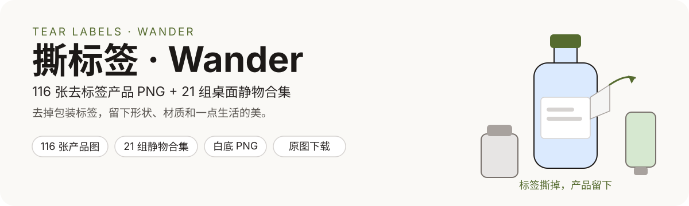
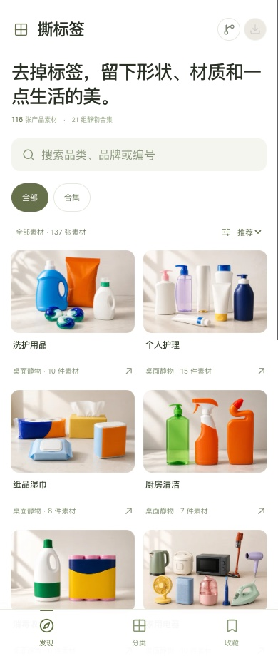
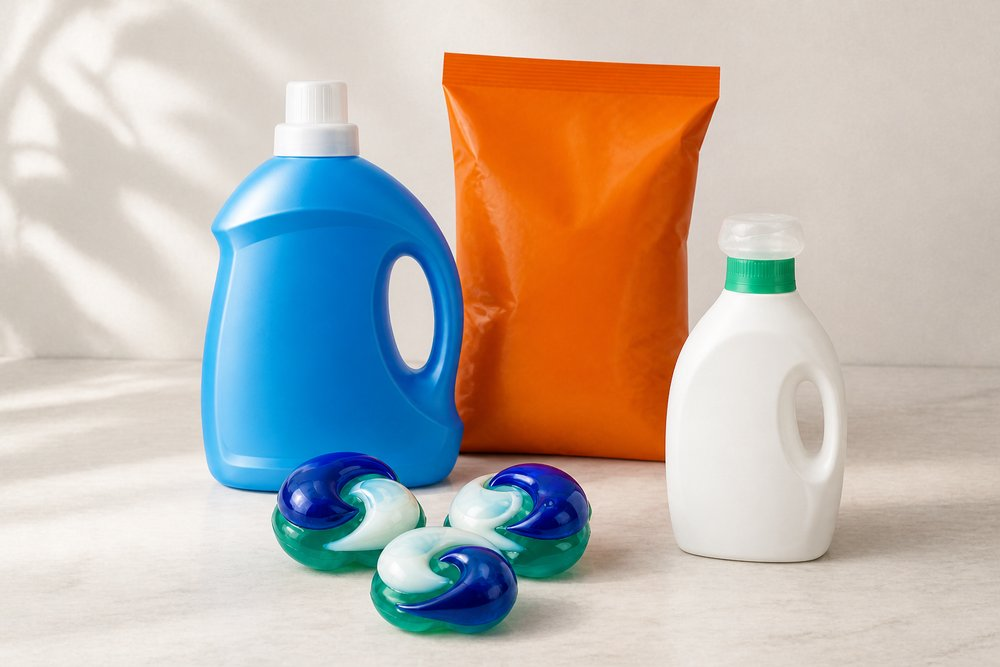

<p align="right"><a href="README.en.md">English</a></p>

<p align="center">
  
</p>

<p align="center">
  <a href="https://daily-necessities-library.xiaosang.cc/">▶ 在线浏览</a>
  ·
  <a href="https://github.com/holynova/daily-necessities-library">GitHub 仓库</a>
  ·
  <a href="https://holynova.github.io/daily-necessities-library/">备用镜像</a>
</p>

撕标签是一个去品牌日用品素材库：116 张去标签产品 PNG 与 21 组桌面静物合集。包装上的 Logo、商标与标签文字全部去掉，只留下产品的形状、材质与颜色，统一纯白商品摄影底，拿来就能用。Wander 界面以橄榄绿分类标签、双列瀑布流与底部导航浏览，首页合集优先。

## 截图

<p align="center">
  
  
</p>

## 内容

- **116 张产品图**：日用 top 40（洗衣液、洗发水、牙膏、纸巾、厨房清洁、小家电、饮料食品……）+ 品牌专题 36（宝洁、雀巢、百事、联合利华、茅台、伊利、蓝月亮、抽纸）+ 新增快销品 40（可口可乐、汰渍、佳洁士、红牛、星巴克……）。
- **21 组静物合集**：14 组品类合集（洗护、个护、纸品、厨房清洁……）+ 7 组快销品细分合集，每组是一张桌面静物合照。
- **去标签规范**：包装表面完整，无标签、无残留字样、无撕裂边、无胶痕；不展示 Logo、商标、功效宣称。
- **图片名称与品牌参考沿用现有素材元信息**，下载保留原始白底 PNG；「最常见」是代表性选品，不构成销量排名。

## 功能

- **分类目录、全库搜索**：按品类、品牌或编号搜索；推荐 / 最新 / 名称三种排序。
- **本地收藏**：收藏存在浏览器本地。
- **原图下载**：列表用 WebP 缩略图，详情解码后升级高清 WebP，下载仍取 PNG 原图。
- **分享**：分享二维码与 PNG 海报导出。
- **浏览体验**：首批 12 张，滚动追加；桌面四列、手机双列；键盘翻图、触摸滑动、减少动态效果。

## 本地运行

```bash
npm ci
npm run dev
```

生成详情图与缩略图（sharp）：

```bash
npm run assets:details
npm run assets:thumbs
```

## 技术

- React 19 + Vinext（Next.js 风格 RSC）+ shadcn/ui + Tailwind CSS 4；静态构建后发布。
- 图片三级：原始 PNG（`public/assets/`）+ 详情 WebP（`public/assets/details/`）+ 列表缩略图（`public/assets/thumbnails/`），`manifest.json` 记录 137 张图的指纹映射。
- 设计文档见 `PRODUCT.md` 与 `DESIGN.md`，发布检查见 `release-qa.md`。

```
public/assets/                    116 张原始 PNG + 21 组静物合集
public/assets/details/            137 张详情 WebP + manifest.json
public/assets/thumbnails/         137 张列表缩略图
app/                              界面入口与全局样式
components/ui/                    shadcn/ui 组件
scripts/                          generate-details / generate-thumbnails / generate-image-dimensions
```
